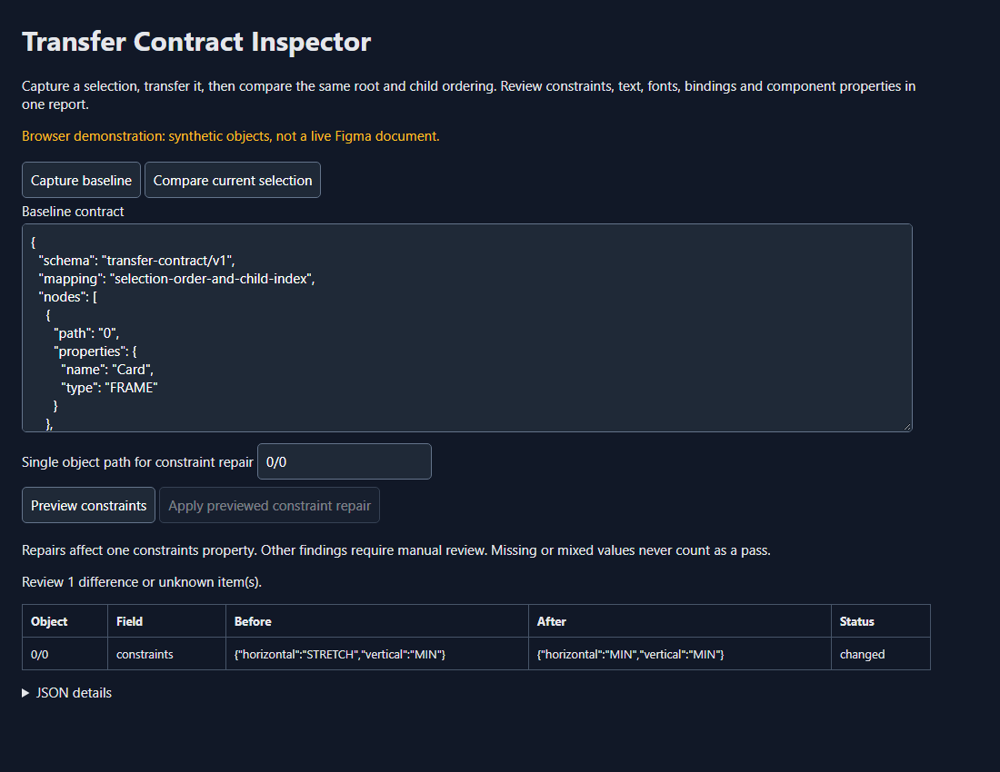

# Transfer Contract Inspector for Figma

Two frames can look alike while behaving differently when resized. This plugin compares selected text, font settings and resizing rules before and after a transfer, bringing the checked differences into one report.

Imagine copying a title into another frame. At the current window size it looks right, but its resizing rule has changed: it is now pinned to the left rather than stretching with the frame. You may not notice until you try a different layout size.

**Example:** The demonstration changes a title's horizontal resizing rule. Capture the original settings, compare the corresponding selection, and inspect that difference. The supported repair can restore one object's saved resizing rule after you preview it.

**What you install:** A Figma development plugin, with a separate browser demonstration.

**Current scope:** This checks a limited set of properties, not a complete visual match or every component relationship. Object order matters. The browser example and tests using a simulated Figma interface passed; installation and undo in a real Figma session remain unverified.

[Live guide](https://az9713.github.io/rea-figma-transfer/) · [Download packages](https://github.com/az9713/rea-figma-transfer/releases/tag/v0.1.0)

## Before and after

| Before | With this plugin |
| --- | --- |
| A transfer can look similar while constraints, text, fonts or variable bindings differ. | A declared contract reports each changed or missing field at its structural object path. |
| Manually inspect a title's constraint settings. | Preview a single constraint repair and apply it only if the selection state and target object are still the previewed ones. |
| A mixed property can disappear in a simplistic serializer. | Mixed/unavailable properties remain explicit unknowns and prevent a passing result. |



## Install and use

1. Download `transfer-contract-inspector-0.1.0.zip` from Releases and extract it.
2. In Figma desktop, import a development plugin from the extracted `manifest.json`. Assign a local development ID through Figma if required by your build.
3. Select non-overlapping roots in a stable order. Run the plugin and capture the baseline JSON. Save that JSON yourself before closing the plugin.
4. Perform your transfer using the existing tool. Select corresponding roots in the same order and compare.
5. Review the structural mapping and all unknowns. For a supported object, enter its path, preview its constraints, then apply. Use Figma Undo if needed.

The plugin runs without network access. A browser demo uses synthetic objects and cannot inspect your Figma account.

## Supported contract

Compares a bounded selection tree (2,500 nodes, depth64): names/types, visibility, opacity, geometry dimensions/rotation, constraints, selected layout properties, text/font properties, variable bindings/modes, component properties and exposed overrides when present. It does not represent all Figma semantics. Structural position is not proof of cross-file component/variable identity; reorderings and changed IDs require interpretation. No automatic remapping is attempted.

Repairs only one `constraints` property per action. No font loading, token remapping, component swapping or bulk repairs. No vendor file/clipboard decoder is included.

## Build and verification

Node22 or later, no package dependencies:

```sh
node --test tests/contract.test.js
node scripts/build.js
```

Package `dist/manifest.json` and `dist/code.js` as a ZIP. The tests cover contract losses, unknown values, malformed data, structural ambiguity, and stale/replaced-object repair rejection. Plugin integration tests use an API double, not the proprietary Figma runtime. Real Figma installation and undo behavior remain unverified in this release. The live browser comparison is separately tested in Chromium.

## REA and source investigation

This is an original public-API extension. Earlier REA6.3 package inspection failed on a container-range contradiction; that does not establish a hidden transfer defect. The official Plugin API already exposes much of the required contract. No decompiled Figma source is published, and no measured superiority over every existing transfer/lint plugin is claimed. Native clipboard investigation remains conditional on a real failing fixture.

Official references: [plugin quickstart](https://developers.figma.com/docs/plugins/plugin-quickstart-guide/), [manifest](https://developers.figma.com/docs/plugins/manifest/), [constraints](https://developers.figma.com/docs/plugins/api/properties/nodes-constraints/), [bound variables](https://developers.figma.com/docs/plugins/api/properties/nodes-boundvariables/), [InstanceNode](https://developers.figma.com/docs/plugins/api/InstanceNode/). Existing baseline: native variables, Tokens Studio and Design Lint.

## License and compatibility

Original project code: MIT. Figma is separately installed proprietary software; this repository includes no Figma binaries or branding assets. Unaffiliated experimental plugin. Check the release notes and declared limitations before using it on valuable documents.
